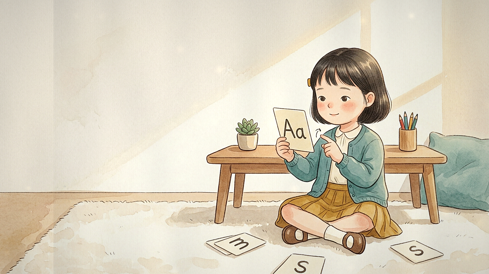

# From Phonics to Reading — 8-second looping animation

A hand-painted watercolour and coloured-pencil storybook loop that follows one
Korean elementary-school girl through five reading milestones.



---

## Deliverables

| File | What it is |
| --- | --- |
| `animation/from-phonics-to-reading-loop.mp4` | **Master.** 1920×1080, 24 fps, 8.00 s, H.264 High, BT.709, faststart |
| `animation/from-phonics-to-reading-loop.webm` | VP9 web build (smaller, good for `<video>`) |
| `animation/preview-loop.gif` | 480 px looping GIF for previews, docs and chat |
| `animation/poster-16x9.png` | Clean still, milestone 1 — usable as a poster/thumbnail |
| `animation/stills/` | One clean 1920×1080 still per milestone |
| `animation/label-safe-areas.png` | Guide showing where each milestone leaves clear paper |
| `scenes/` | The five hand-painted keyframes (source art) |
| `characters/girl-reference-sheet.png` | Character reference sheet used to keep her identical |
| `render/` | Reproducible renderer (Python + Pillow) |

---

## The five milestones

Each milestone holds for **1.60 s**; the loop is **8.00 s** at **24 fps**.

| # | Milestone | In | Out | Clean space for labels |
| --- | --- | --- | --- | --- |
| 1 | Discovering individual letter sounds (`Aa`, `m`, `s` cards) | 0.00 s | 1.60 s | upper-left, ~43 % × 41 % |
| 2 | Blending letters to read **cat** (`c`–`a`–`t` blocks) | 1.60 s | 3.20 s | upper-left, ~39 % × 32 % |
| 3 | Advanced phonics patterns (`sh`, `ch`, `th`, `ee`) | 3.20 s | 4.80 s | right third, ~35 % × 41 % |
| 4 | Reading a sentence in a beginner reader | 4.80 s | 6.40 s | upper-left, ~34 % × 37 % |
| 5 | Illustrated chapter book, cozy library | 6.40 s | 8.00 s | upper-left, ~48 % × 34 % |

Transitions are 0.60 s page-turns that overlap the end of each slot.

---

## Design specs

- **Aspect / size:** 16:9, 1920×1080, 24 fps, 8.00 s (192 frames), no audio.
- **Palette:** warm ivory paper (`#F7F2E5`), muted teal (`#5C8F8B`), golden
  mustard (`#B08A37`), soft brown and a whisper of coral blush.
- **Character:** fixed design throughout — round face, chin-length black-brown
  bob with wispy bangs, mustard ribbon clip on her left, teal knit cardigan over
  a cream blouse, mustard pleated skirt, ivory socks, brown Mary Janes.
- **Motion:** slow push-in with a settle, 1–3 px drift, a warm light sweep,
  drifting dust motes and a paper-grain plate. No cuts, no camera jolts.
- **Emotion:** understated — a small smile at most (milestone 2 opens into a
  brief delighted grin at the "cat" moment). No props anthropomorphise.
- **Seamless loop:** milestone 5's page-turn wipes straight back into milestone 1.
  Frame 191 → frame 0 differs by about the same amount as any two adjacent
  frames, so the join is invisible.
- **No text or watermark** is ever drawn into the frame. The only letters on
  screen are the content of the reading lesson itself (alphabet cards, the
  `c-a-t` blocks, the `sh`/`ch`/`th`/`ee` cards). Book pages use soft suggested
  lines, not legible words.

---

## Adding text labels

Use `animation/label-safe-areas.png` as the map. Each milestone reserves a
large, flat ivory area that nothing in the animation enters except drifting dust
motes — safe for headings, captions or a title card. If you need text in a
position other than those boxes, the upper-left region of every scene is the
calmest, and the `stills/` folder gives you exact frames to lay out against.

---

## Rebuilding

Requires Python 3.11+ with `pillow` and `numpy`, plus an ffmpeg binary
(`imageio-ffmpeg` provides a static one).

```bash
python3 -m venv .venv && .venv/bin/pip install pillow numpy imageio-ffmpeg
cd assets/render

# fast preview of six frames
.venv/bin/python render_loop.py --preview /tmp/preview.png

# full render + encode (writes into assets/animation/)
.venv/bin/python encode.py --jobs 2

# regenerate the label guide (needs a render first)
.venv/bin/python label_guide.py
```

Tunables live at the top of `render_loop.py`:

- `SLOT`, `TRANS`, `FPS` — timing.
- `SCENE_TUNE` — per-scene focal point, drift and `zs` (a zoom bias that keeps
  the girl roughly the same size on screen in every painting).
- `ZOOM_START` / `ZOOM_END` — how much of the painting is visible at the
  beginning and end of each shot (fraction of the artwork).
- `PAPER_RGB` — the ivory the page-turn leaf is painted in.

To change the art, replace the PNGs in `scenes/` (16:9, ideally ≥1920 px wide)
and re-run `encode.py`. `load_scenes()` normalises the paper white-point across
paintings so transitions don't flicker.
